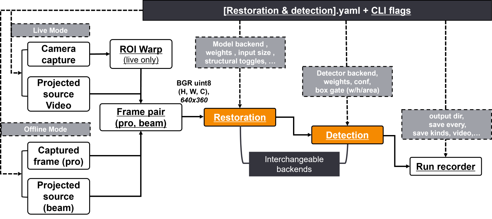

# ProRes-Det

[](https://doi.org/10.5281/zenodo.22153822)

**Pro**jector **Res**toration + **Det**ection

A camera pointed at a screen sees whatever the projector throws on it. This framework
removes that light, then measures object detection before and after the removal.

The restoration model and the detector both sit behind small interfaces, so either can be
swapped without touching the pipeline.



Both modes converge on the same `(distorted, light)` frame pair, so everything downstream
is shared. `evaluate.py` runs the detector on both sides of the restoration step and scores
the difference — mAP, PSNR, SSIM.

| Guide | Covers |
|---|---|
| [COMMANDS.md](COMMANDS.md) | Every command and flag in one lookup table, plus the interactive keys |
| [README_running.md](README_running.md) | `demo.py` · `evaluate.py` · `train.py` — every option, input, output |
| [projector_distortion/README_code.md](src/projector_distortion/README_code.md) | What each module owns, the call graph, the public API |
| [datasets/README_data.md](datasets/README_data.md) | The three splits, layout, filename rules, both label formats, every `Data.py` stage |
| [weights/README_weights.md](weights/README_weights.md) | The three checkpoints, checkpoint format, the residual convention |

---

## 1. Install

Python ≥ 3.9.

```bash
git clone <repo> && cd ProRes-Det
conda create -n prores-det python=3.10 -y && conda activate prores-det

pip install -e ".[all]" -r requirements-cuda.txt    # GPU
pip install -e ".[all]"                             # CPU only
```

Quote the brackets — they are glob characters in zsh.

`[all]` pulls every extra. Narrower ones exist: `[yolo]` for the `yolo` detector,
`[train]` for `train.py`, `[live]` for `--live` on non-Windows, `[test]` for pytest.

Confirm the GPU took:

```bash
python -c "import torch; print(torch.__version__, torch.cuda.is_available())"
# 2.9.0+cu128 True
```

`requirements-cuda.txt` is needed because the default PyPI `torch` carries no CUDA on
Windows. Every entry point prints the device it resolved as its first line, so a run that
fell back to the CPU says so.

---

## 2. Run

```bash
python src/demo.py                    # restore + detect 22 bundled pairs → output/<timestamp>/
python src/evaluate.py                # before/after mAP + PSNR/SSIM     → output/Eval_<dataset>/
python src/train.py --epochs 30       # retrain the restorer             → runs/<tag>/
python src/demo.py --live             # webcam + projector rig           → output/<timestamp>/
python src/Data.py capture_warp       # collect your own data (see below) → datasets/Create_Data/warp_<MMDD>/
python src/Data.py record --screen 2  # project + record, no models      → datasets/recordings/
python src/demo.py --video-pair datasets/recordings/rec_<t>.mp4   # replay that recording → result.mp4
```

The first three need no arguments. Sample data and all three checkpoints are tracked in
git, so a clone runs as-is. An editable install also puts `pdf-demo`, `pdf-evaluate` and
`pdf-train` on the PATH; they are thin wrappers around the same three scripts.

The bundled dataset is split three ways under `datasets/SampleData/`, and each entry point
defaults to its own split:

| Split | Contents | Default for |
|---|---|---|
| `sample_train` | 1,000 pairs, 20 scenes, no labels | `train.py` |
| `sample_eval` | 22 pairs, 10 scenes, 107 boxes | `demo.py`, `evaluate.py` |
| `sample_test` | 200 pairs, 5 scenes, 53 boxes | held out — pass `--input`/`--gt` to reach it |

The scenes do not overlap, so a model trained on `sample_train` is scored on frames it has
never seen. Details and the two label formats: [datasets/README_data.md](datasets/README_data.md).

**Run from the repo root.** Config paths resolve against the project root, but the
`train.data` globs are read against the working directory.

Swapping a model leaves every path unchanged — it is a one-line edit in
[configs/detection.yaml](src/projector_distortion/configs/detection.yaml), not a flag:

```yaml
detector:
  backend: ssd      # no ultralytics needed
  # backend: none   # restoration only
```

```bash
python src/demo.py --limit 5          # first 5 pairs
```

`--live` needs a webcam and a projector. Which monitor it projects on, which webcam
watches, and the projector→camera latency are properties of the machine, so they live
in [configs/live.yaml](src/projector_distortion/configs/live.yaml) rather than in
flags; `--screen` and `--camera` override the first two for one run. The monitor table
prints at startup, so a wrong guess costs one aborted run rather than a file edit.

The rig and the models do not have to be on the same machine, or in the same week.
`Data.py record` projects a clip and records the camera's view as one raw mp4 with no
models loaded; `demo.py --video-pair` turns that file back into a run — rectifying it,
pairing every camera frame with the clip frame that caused it, and writing the restored
video. One argument is enough, because the `.json` written beside the mp4 already names
the clip and the rate the camera actually managed:

```bash
python src/Data.py record --screen 2 --seconds 30               # on the rig
python src/demo.py --video-pair datasets/recordings/rec_<t>.mp4 # anywhere, later
```


Collecting your own data is `Data.py`, which dispatches to the stage scripts under
`datasets/` — `check`, `make_light`, `capture`, `warp`, `record`. Everything lands
under `datasets/Create_Data/`, ready for `--input` and `--data-root`:
[datasets/README_data.md](datasets/README_data.md).

Every flag and its default: [COMMANDS.md](COMMANDS.md). Why each entry point behaves
the way it does: [README_running.md](README_running.md).


Step 1 is `Data.py`, step 2 is `train.py` and the restorer, step 3 is `demo.py` and
`evaluate.py`. The bundled sample data already carries step 1's output, so a clone starts
at step 2.

---

## 3. Reference results

What this repository produces as shipped, so a run can be checked against it rather
than taken on trust. Reproduce with the commands in each caption — no flags beyond the
split, and no edits except where noted.

### Detection, before vs after restoration

`sample_test` is the headline: it is held out, it is 9× the size of `sample_eval`, and
no checkpoint here was fitted on it.

**`sample_test`** — 200 pairs, 5 scenes, 2,131 ground-truth box instances

| Backend | Source | P | R | F1 | mAP@0.5 | TP | FP | FN |
|---|---|---|---|---|---|---|---|---|
| yolo | distorted | 0.8143 | 0.7611 | 0.7868 | 0.7804 | 1622 | 370 | 509 |
| yolo | **restored** | 0.9977 | 0.9986 | 0.9981 | **0.9952** | 2128 | 5 | 3 |
| | | | | | **+0.2148** | | | |
| ssd | distorted | 0.5428 | 0.7236 | 0.6203 | 0.7091 | 1542 | 1299 | 589 |
| ssd | **restored** | 0.9861 | 0.9977 | 0.9918 | **0.9968** | 2126 | 30 | 5 |
| | | | | | **+0.2877** | | | |

**`sample_eval`** — 22 pairs, 10 scenes, 225 ground-truth box instances

| Backend | Source | P | R | F1 | mAP@0.5 | TP | FP | FN |
|---|---|---|---|---|---|---|---|---|
| yolo | distorted | 0.8627 | 0.8933 | 0.8777 | 0.8843 | 201 | 32 | 24 |
| yolo | **restored** | 1.0000 | 1.0000 | 1.0000 | **1.0000** | 225 | 0 | 0 |
| | | | | | **+0.1157** | | | |
| ssd | distorted | 0.6793 | 0.8756 | 0.7650 | 0.8086 | 197 | 93 | 28 |
| ssd | **restored** | 0.9956 | 1.0000 | 0.9978 | **1.0000** | 225 | 1 | 0 |
| | | | | | **+0.1914** | | | |

The gain holds across two architectures that share nothing but the images they are
handed, so it is a property of the restoration rather than of one detector.

### Restoration quality

| Split | PSNR distorted | PSNR restored | gain | SSIM distorted | SSIM restored | gain |
|---|---|---|---|---|---|---|
| `sample_test` | 16.812 dB | 22.741 dB | +5.929 | 0.7189 | 0.8924 | +0.1735 |
| `sample_eval` | 13.760 dB | 26.928 dB | +13.168 | 0.7051 | 0.9227 | +0.2176 |

PSNR and SSIM do not depend on the detector, so one row per split covers both backends.

Note the two move in opposite directions between the splits: `sample_eval` gains far
more PSNR while `sample_test` gains far more mAP. Pixel fidelity and detectability are
not the same axis, which is the reason this project scores both.

### Reproducing

```bash
python src/evaluate.py                                       # sample_eval, ssd
python src/evaluate.py --input datasets/SampleData/sample_test                    --gt    datasets/SampleData/sample_test   # sample_test, ssd
```

`ssd` is the default detector, so those two commands reproduce the `ssd` rows exactly.
The `yolo` rows need one edit, because the detector is configured and never flagged —
set `detector.backend: [yolo, ssd]` in
[configs/detection.yaml](src/projector_distortion/configs/detection.yaml) and each entry
becomes a row of the same report. That also opts into AGPL-3.0; see
[THIRD_PARTY.md](THIRD_PARTY.md).

Numbers were produced on the checkpoints tracked in this repository at
`detector.conf: 0.25` and `--iou 0.5`, the shipped defaults. Restoration is
deterministic, so a rerun on the same weights reproduces these to the printed digits;
a different GPU may move the last decimal.

---

## 4. Layout

```
ProRes-Det/
├── README.md  LICENSE.txt  THIRD_PARTY.md  COMMANDS.md  README_running.md
├── setup.py  requirements.txt  requirements-cuda.txt
│
├── src/                      all source lives here
│   ├── demo.py               restore → detect, end to end (offline / --live / --video-pair)
│   ├── evaluate.py           detection before/after + restoration quality
│   ├── train.py              fine-tune the restoration model
│   ├── Data.py               dataset collection: one entry point for every stage
│   ├── projector_distortion/ the library → README_code.md
│   │   ├── configs/          default settings (YAML)
│   │   ├── models/           restoration + detection models
│   │   ├── pipeline/         offline / live / replay run loops
│   │   └── utils/            image, visualization, recording and display helpers
│   └── tests/                pytest suite, 151 tests
│
├── datasets/                 SampleData/ (train · eval · test), live/ clips, and the
│                             collection scripts Data.py drives; 349 MiB tracked
├── weights/                  3 checkpoints, 51 MiB, tracked in git
├── Image/                    the figures above
└── output/                   run artefacts (git-ignored)
```

What each module owns and how they call each other:
[projector_distortion/README_code.md](src/projector_distortion/README_code.md).

---

## 5. Configuration

```
configs/*.yaml  <  CLI flags
```

| File | Holds |
|---|---|
| [restoration.yaml](src/projector_distortion/configs/restoration.yaml) | Restoration backend, weights, input size, the ablation toggles, training hyperparameters and loss weights |
| [detection.yaml](src/projector_distortion/configs/detection.yaml) | Detector backend, per-backend weights, confidence floor, box size gate, the 17 class names |
| [live.yaml](src/projector_distortion/configs/live.yaml) | The `--live` rig: monitor, webcam, projector→camera latency, calibration review |
| [collect.yaml](src/projector_distortion/configs/collect.yaml) | Everything `Data.py` reads: session folders, light extraction, capture rig, warp geometry, recording |

No model setting has a CLI flag. What remains on the command line is about *this* run —
which data, where the output goes, how much to process — so a checkpoint or a threshold
is edited in place rather than remembered as an argument:

```yaml
# projector_distortion/configs/detection.yaml
detector:
  backend: ssd
  conf: 0.4
```

Relative paths inside a config resolve against the project root — except the three
`train.data` entries, which are globbed as written and so read against the working
directory. Setting-by-setting:
[COMMANDS.md](COMMANDS.md#settings-that-have-no-flag).

---

## 6. Swapping modules

### Add a detector

```python
from projector_distortion.models.base import BaseDetector, Detection, register_detector

@register_detector("mydet")
class MyDetector(BaseDetector):
    name = "mydet"

    def __init__(self, weights, class_names=None, conf=0.25, device="cpu", **_):
        super().__init__(class_names or [], conf, device)
        self.net = load_my_model(weights)

    def detect(self, bgr):
        return [Detection(cls_id, self.label_of(cls_id), score, (x1, y1, x2, y2))
                for cls_id, score, (x1, y1, x2, y2) in self.net(bgr)]
```

That is the whole change. `detector.backend: mydet` in
[configs/detection.yaml](src/projector_distortion/configs/detection.yaml) works
immediately, and the pipeline, recording and evaluation code stay exactly as they were.

### Add a restorer

The same shape, one registry along:

```python
from projector_distortion.models import BaseRestorer, register_restorer

@register_restorer("myrest")
class MyRestorer(BaseRestorer):
    name = "myrest"

    def restore(self, distorted_bgr, light_bgr):
        return self.net(distorted_bgr), residual_or_zeros
```

`model.backend: myrest` in
[configs/restoration.yaml](src/projector_distortion/configs/restoration.yaml) is the
whole change. Both the backend and its checkpoint come from the config; there is no
flag for either.

`light` — the frame the projector emitted at that moment — is passed to every restorer
because it is the one signal a ProCam rig has and an ordinary restoration setting does
not. A single-image backend simply ignores it.

Interfaces, the call graph and the public API:
[README_code.md](src/projector_distortion/README_code.md).

---

## 7. Tests

```bash
python -m pytest -q
```

---

## 8. License

MIT for this project's own source, data and restoration weights — see
[LICENSE](LICENSE.txt).

The repository also redistributes third-party artefacts under their own licences. One
of them, `weights/detector_yolo11s.pt`, is **AGPL-3.0**, because it is a fine-tune of
an Ultralytics YOLO11 checkpoint. The default configuration does not use it: the
shipped `detector.backend` is `ssd`, torchvision's BSD-licensed SSDLite, so an
out-of-the-box run touches only MIT/BSD/Apache code. Selecting `yolo` opts into
AGPL-3.0.

Full accounting, upstream links and the architectures this work reimplements:
[THIRD_PARTY.md](THIRD_PARTY.md).

---

## 9. Citation

If this software is useful in your research, please cite it. Zenodo mints a DOI per
release; the one below resolves to this version.

```bibtex
@software{lee_prores_det,
  author  = {Lee, JeongHyun},
  title   = {{ProRes-Det: Projector Restoration and Detection}},
  year    = {2026},
  version = {1.0.0},
  doi     = {10.5281/zenodo.22153822},
  url     = {https://github.com/jhyun-lee/ProRes-Det}
}
```

---

## 10. Contact

Questions, bug reports and attribution corrections:
[ljhyun0821@gnu.ac.kr](mailto:ljhyun0821@gnu.ac.kr), or open an issue on the
repository.
